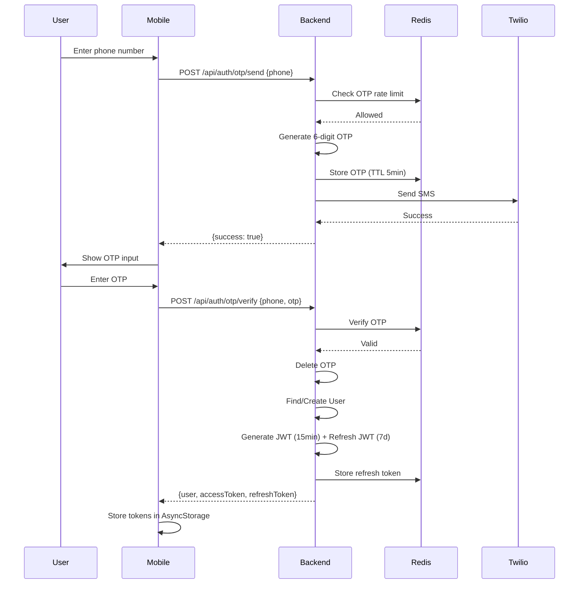

# Mobile-Backend Integration Assessment Plan

## Executive Summary

This assessment analyzes the complete integration between the Farm Connect V2 mobile application (React Native/Expo) and its Express.js backend. The analysis covers authentication workflows, network communication patterns, error handling, security practices, and failure scenarios.

---

## 1. Network Architecture Overview

### 1.1 Technology Stack

| Layer | Technology | Version/Details |
|-------|-----------|-----------------|
| Mobile HTTP Client | Ky | ^1.7.5 |
| Mobile State | Zustand | ^5.0.12 with AsyncStorage persistence |
| Real-time | Socket.io-client | ^4.8.1 |
| Backend Server | Express.js | ^4.21.2 |
| WebSocket Server | Socket.io | ^4.8.1 |
| Database | PostgreSQL via Prisma | ^6.6.0 |
| Cache/OTP | Upstash Redis | ^1.34.3 |
| Auth | JWT | jsonwebtoken ^9.0.2 |

### 1.2 API Endpoints Summary

```
Backend Routes:
├── /api/auth/        (OTP send, verify, refresh, logout)
├── /api/users/       (profile, push tokens)
├── /api/listings/    (CRUD for farm listings)
├── /api/contracts/   (contract management)
├── /api/wallet/      (balance, transactions)
├── /api/payments/    (Razorpay integration)
├── /api/escrow/      (fund holding/release)
├── /api/deliveries/  (harvest tracking)
├── /api/disputes/    (dispute management)
├── /api/reviews/     (ratings)
├── /api/chat/        (messaging)
├── /api/kyc/         (identity verification)
├── /api/notifications/ (push notifications)
└── /api/admin/       (admin operations)
```

---

## 2. Authentication Workflow Analysis

### 2.1 Current Flow



### 2.2 Token Management

**Access Token:**
- Expiry: 15 minutes
- Storage: AsyncStorage (persisted via Zustand)
- Usage: Bearer token in Authorization header

**Refresh Token:**
- Expiry: 7 days  
- Storage: AsyncStorage + Redis (server-side)
- Rotation: New refresh token issued on each refresh

### 2.3 Current Implementation Analysis

**Mobile Side (api.ts:72-109):**
```typescript
// Token refresh interceptor
if (err instanceof HTTPError && err.response.status === 401) {
  if (isRefreshing) {
    // Queue concurrent requests
    return new Promise((resolve, reject) => {
      subscribeTokenRefresh(async (newToken) => {
        try {
          const data = await doRequest(newToken);
          resolve({ data });
        } catch (e) { reject(e); }
      });
    });
  }
  isRefreshing = true;
  const { refreshTokens } = useAuthStore.getState();
  const newToken = await refreshTokens();
  // Retry with new token...
}
```

**Issues Identified:**
1. No exponential backoff on refresh failure
2. No retry count limit on refresh attempts
3. No token pre-refresh before expiry (should refresh at 80% of lifetime)
4. Refresh token stored in AsyncStorage (security risk if device compromised)

---

## 3. Request/Response Flow Analysis

### 3.1 HTTP Request Flow

**Request Construction (api.ts:36-70):**
```typescript
async function request<T>(method: Method, path: string, body?: unknown) {
  const { accessToken } = useAuthStore.getState();
  
  const headers = {
    ...(isFormData ? {} : { "Content-Type": "application/json" }),
    ...(accessToken ? { Authorization: `Bearer ${accessToken}` } : {}),
  };

  const opts = {
    method,
    headers,
    timeout: 15000,  // 15 second timeout
    ...(body ? { json: body } : {}),
  };

  return ky(`${BASE_URL}${path}`, opts).json<T>();
}
```

### 3.2 Response Format

All responses follow a consistent structure:
```typescript
interface ApiResponse<T> {
  success: boolean;
  data?: T;
  message?: string;
  error?: {
    code: string;
    message: string;
    errors?: Array<{ field: string; message: string }>;
  };
  pagination?: {
    total: number;
    page: number;
    limit: number;
    pages: number;
  };
}
```

### 3.3 Data Consistency Mechanisms

**Current Implementation:**
- No optimistic locking (ETag/If-Match headers)
- No version fields in data models
- No conflict resolution on concurrent updates
- Database transactions used in services but no client-side conflict handling

---

## 4. Error Handling Analysis

### 4.1 Backend Error Handling

**Custom Error Classes (errors/index.ts):**
- AppError (base)
- NotFoundError (404)
- UnauthorizedError (401)
- ForbiddenError (403)
- BadRequestError (400)
- ConflictError (409)

**Error Handler (errors/index.ts:48-89):**
- Catches Zod validation errors
- Formats AppError instances
- Generic 500 for unexpected errors

### 4.2 Mobile Error Handling

**Error Boundary (ErrorBoundary.tsx):**
- Catches React render errors
- Shows error UI with "Try Again" button

**Error Handler Utility:**
- Console logging with context
- No centralized error reporting

**API Error Parsing:**
```typescript
// From authStore.ts:9-23
const getErrorMessage = async (err: unknown, fallback: string) => {
  if (err instanceof HTTPError) {
    try {
      const body = await err.response.json();
      return body?.message || body?.error?.message || fallback;
    } catch { return fallback; }
  }
  return fallback;
};
```

### 4.3 Issues Identified

1. No exponential backoff for retryable errors (5xx, network failures)
2. No circuit breaker pattern
3. No dead letter queue for failed requests
4. No structured error logging/monitoring
5. Generic "An unexpected error occurred" masks root causes

---

## 5. Real-Time Communication (WebSocket)

### 5.1 Socket.io Configuration

**Mobile Connection (socketStore.ts:32-37):**
```typescript
const newSocket = io(BASE_URL, {
  auth: { token: accessToken },
  reconnection: true,
  reconnectionAttempts: 5,
  reconnectionDelay: 1000,
});
```

**Backend Authentication (server.ts:18-30):**
```typescript
io.use((socket, next) => {
  const token = socket.handshake.auth?.token;
  if (!token) return next(new Error("Unauthorized"));
  try {
    const payload = jwt.verify(token, env.jwt.secret);
    socket.data.userId = payload.userId;
    next();
  } catch { next(new Error("Unauthorized")); }
});
```

### 5.2 Issues Identified

1. No heartbeat/ping-pong to detect stale connections
2. No message acknowledgment mechanism
3. Limited to 5 reconnection attempts with fixed delay
4. No message persistence for offline users
5. Chat messages only handled via global listener, no per-conversation handling visible

---

## 6. Security Analysis

### 6.1 Current Security Measures

**Backend:**
- Helmet.js for HTTP headers
- CORS with configurable origin
- Rate limiting (100 req/15min general, 10 req/15min auth)
- JWT authentication middleware
- Zod input validation
- sanitize-html for XSS prevention

**Mobile:**
- Tokens stored in AsyncStorage (not secure enclave)
- No certificate pinning
- Base URL defaults to localhost (development risk)

### 6.2 Security Gaps

| Issue | Risk Level | Description |
|-------|-----------|-------------|
| Token in AsyncStorage | HIGH | Can be extracted on rooted/jailbroken devices |
| No certificate pinning | HIGH | Man-in-the-middle attacks possible |
| No HTTPS enforcement | MEDIUM | Data transmitted in plaintext |
| CORS origin hardcoded | MEDIUM | May not adapt to different environments |
| No request signing | MEDIUM | Replay attacks possible |
| No IP binding for tokens | LOW | Token works from any IP |

### 6.3 Token Storage Comparison

**Current (AsyncStorage):**
```typescript
// From authStore.ts:180-189
partialize: (state) => ({
  accessToken: state.accessToken,
  refreshToken: state.refreshToken,
  // Stored in plain text
}),
```

**Recommended Secure Alternative:**
- Use react-native-keychain or expo-secure-store
- Encrypt tokens with device-specific key

---

## 7. Performance & Latency Analysis

### 7.1 Current Configuration

- Request timeout: 15 seconds
- No request caching
- No request deduplication
- Pagination: client-controlled

### 7.2 Performance Bottlenecks Identified

1. **No response caching** - Same data fetched repeatedly
2. **No request batching** - Multiple API calls for related data
3. **No prefetching** - No intelligent data prefetch
4. **Socket reconnection delay** - Fixed 1 second, no backoff
5. **No image optimization** - Full-resolution images loaded

### 7.3 Database Query Analysis

- No visible query optimization (SELECT * patterns)
- Missing database indexes visible in Prisma schema
- N+1 query potential in listing with farmer data

---

## 8. Edge Cases & Failure Scenarios

### 8.1 Network Failure Scenarios

| Scenario | Current Handling | Recommended |
|----------|------------------|--------------|
| No internet | No retry | Queue requests, retry with exponential backoff |
| Slow response | 15s timeout | Configurable timeout per endpoint |
| DNS failure | Ky throws | Fallback to cached IP |
| Server 5xx | No retry | Retry with backoff |

### 8.2 Authentication Failure Scenarios

| Scenario | Current Handling | Recommended |
|----------|------------------|--------------|
| Token expired | Auto-refresh | Already implemented |
| Refresh token expired | Logout user | Clear error message |
| Device clock skew | May fail JWT | Accept ±5 min clock skew |
| Concurrent token refresh | Queue requests | Correctly handled |

### 8.3 Data Consistency Scenarios

| Scenario | Current Handling | Recommended |
|----------|------------------|--------------|
| Offline mode | No offline support | Implement offline-first with sync |
| Concurrent edits | Last write wins | Add version/ETag for conflict detection |
| Partial upload | Fails silently | Implement resumable uploads |
| Payment failure | Error shown | Retry with idempotency key |

---

## 9. Test Plan for Critical Integration Points

### 9.1 Authentication Flow Tests

| Test Case | Steps | Expected Result |
|-----------|-------|-----------------|
| OTP Send | POST /api/auth/otp/send with valid phone | OTP stored, SMS sent (or logged in dev) |
| OTP Verify | POST /api/auth/otp/verify with correct OTP | Returns access + refresh tokens |
| OTP Expiry | Verify OTP after 5 minutes | Returns 401 "Invalid or expired OTP" |
| Token Refresh | POST /api/auth/refresh with valid refreshToken | Returns new access + refresh tokens |
| Logout | POST /api/auth/logout | Refresh token invalidated in Redis |

### 9.2 Token Security Tests

| Test Case | Steps | Expected Result |
|-----------|-------|-----------------|
| Expired Access | Use expired JWT | Returns 401 "Invalid or expired token" |
| Invalid Token | Use forged JWT | Returns 401 "Invalid or expired token" |
| Missing Token | Request without Authorization header | Returns 401 "No token provided" |
| Refresh Token Reuse | Reuse old refresh after rotation | Returns 401 "Invalid refresh token" |

### 9.3 API Integration Tests

| Test Case | Steps | Expected Result |
|-----------|-------|-----------------|
| Create Listing | POST /api/listings with auth | Returns 201 with listing data |
| Get Listings | GET /api/listings with pagination | Returns paginated listings |
| Contract Flow | Create → Accept → Complete | Correct status transitions |
| Rate Limit | 101 requests in 15 min | Returns 429 "Too many requests" |

### 9.4 WebSocket Tests

| Test Case | Steps | Expected Result |
|-----------|-------|-----------------|
| Connect with valid token | Socket with Bearer token | Connection established |
| Connect without token | Socket without token | Connection rejected |
| Reconnection | Disconnect and reconnect | Auto-reconnect up to 5 times |
| Message delivery | Emit message event | Message received |

### 9.5 Error Handling Tests

| Test Case | Steps | Expected Result |
|-----------|-------|-----------------|
| Invalid input | POST with malformed data | Returns 400 with validation errors |
| Unauthorized access | Access another user's resource | Returns 403 |
| Not found | GET non-existent resource | Returns 404 |
| Server error | Force 500 error | Returns 500 "An unexpected error occurred" |

---

## 10. Recommendations

### 10.1 Critical Security Improvements

1. **Move tokens to secure storage:**
   ```typescript
   // Use expo-secure-store instead of AsyncStorage
   import * as SecureStore from 'expo-secure-store';
   
   // Store access token
   await SecureStore.setItemAsync('accessToken', token);
   ```

2. **Implement certificate pinning:**
   ```typescript
   // Using axios with certificate pinning
   import axios from 'axios';
   import { PinningService } from '@say2/ios-certificate-pinning';
   ```

3. **Add HTTPS enforcement:**
   ```typescript
   // Force HTTPS in production
   if (env.isProd && !url.startsWith('https')) {
     throw new Error('HTTPS required in production');
   }
   ```

### 10.2 Reliability Improvements

1. **Implement retry with exponential backoff:**
   ```typescript
   async function requestWithRetry<T>(
     fn: () => Promise<T>,
     maxRetries = 3,
     baseDelay = 1000
   ): Promise<T> {
     for (let i = 0; i < maxRetries; i++) {
       try {
         return await fn();
       } catch (err) {
         if (i === maxRetries - 1) throw err;
         await sleep(baseDelay * Math.pow(2, i));
       }
     }
   }
   ```

2. **Add request queue for offline support:**
   ```typescript
   interface QueuedRequest {
     id: string;
     method: Method;
     path: string;
     body?: unknown;
     timestamp: number;
   }
   
   const requestQueue = create<RequestQueueState>((set, get) => ({
     pending: [],
     enqueue: (req) => set(state => ({ 
       pending: [...state.pending, req] 
     })),
     processQueue: async () => {
       const { pending } = get();
       for (const req of pending) {
         try {
           await api.request(req.method, req.path, req.body);
           // Remove from queue on success
         } catch {
           // Keep in queue for retry
         }
       }
     }
   }));
   ```

3. **Implement circuit breaker:**
   ```typescript
   class CircuitBreaker {
     constructor(private threshold = 5, private timeout = 60000) {}
     
     async execute<T>(fn: () => Promise<T>): Promise<T> {
       if (this.failures >= this.threshold) {
         throw new Error('Circuit breaker open');
       }
       try {
         const result = await fn();
         this.failures = 0;
         return result;
       } catch (err) {
         this.failures++;
         throw err;
       }
     }
   }
   ```

### 10.3 Performance Improvements

1. **Add response caching:**
   ```typescript
   const cache = new Map<string, { data: any; expires: number }>();
   
   async function getCached<T>(key: string, fn: () => Promise<T>): Promise<T> {
     const cached = cache.get(key);
     if (cached && cached.expires > Date.now()) {
       return cached.data;
     }
     const data = await fn();
     cache.set(key, { data, expires: Date.now() + 60000 });
     return data;
   }
   ```

2. **Implement token pre-refresh:**
   ```typescript
   // Refresh token when 80% of lifetime has passed
   const TOKEN_LIFETIME = 15 * 60 * 1000; // 15 min
   const PRE_REFRESH_THRESHOLD = TOKEN_LIFETIME * 0.8;
   
   if (tokenIssuedAt && Date.now() - tokenIssuedAt > PRE_REFRESH_THRESHOLD) {
     await refreshTokens();
   }
   ```

### 10.4 Data Consistency Improvements

1. **Add optimistic locking:**
   ```typescript
   interface VersionedResource {
     id: string;
     version: number;
   }
   
   // Include version in updates
   patch: (url, { ...body, expectedVersion: currentVersion })
   
   // Backend checks version
   if (resource.version !== expectedVersion) {
     throw new ConflictError('Resource was modified by another user');
   }
   ```

2. **Implement idempotency keys:**
   ```typescript
   // Generate UUID for payment requests
   const idempotencyKey = uuid();
   await api.post('/api/payments/create-order', 
     { amount, currency },
     { headers: { 'Idempotency-Key': idempotencyKey }}
   );
   ```

### 10.5 WebSocket Improvements

1. **Add heartbeat:**
   ```typescript
   // Client
   setInterval(() => {
     if (socket?.connected) {
       socket.emit('ping');
     }
   }, 30000);
   
   // Server
   socket.on('ping', () => socket.emit('pong'));
   ```

2. **Add message acknowledgment:**
   ```typescript
   socket.emit('message', message, (ack: { id: string }) => {
     // Message confirmed
   });
   ```

---

## 11. Code Snippets Summary

### 11.1 Current API Request Flow (Complete)
```typescript
// Mobile initiates request
const response = await api.get('/api/listings', { 
  searchParams: { page: 1, limit: 10 } 
});

// api.ts builds and executes request
const data = await ky(`${BASE_URL}/api/listings`, {
  headers: { 
    Authorization: `Bearer ${accessToken}`,
    'Content-Type': 'application/json'
  },
  timeout: 15000
}).json();

// On 401, refresh and retry
if (response.status === 401) {
  const newToken = await refreshTokens();
  return ky.with(Authorization: `Bearer ${newToken}`).json();
}
```

### 11.2 Backend Auth Flow (Complete)
```typescript
// Express route receives request
authRouter.post('/otp/verify', validate(verifyOtpSchema), verifyOtpHandler);

// Controller validates OTP via Redis
const isValid = await verifyOtp(input.phone, input.otp);

// Creates JWT with user payload
const payload = { userId, phone, role };
const accessToken = jwt.sign(payload, JWT_SECRET, { expiresIn: '15m' });

// Returns response
res.json({ 
  success: true, 
  data: { user, accessToken, refreshToken } 
});
```

---

## 12. Implementation Priority Matrix

| Priority | Item | Effort | Impact |
|----------|------|--------|--------|
| HIGH | Move to expo-secure-store | 2 days | Security |
| HIGH | Implement retry with backoff | 1 day | Reliability |
| HIGH | Add request timeout per endpoint | 1 day | UX |
| MEDIUM | Implement token pre-refresh | 1 day | UX |
| MEDIUM | Add circuit breaker | 2 days | Reliability |
| MEDIUM | Implement optimistic locking | 3 days | Data integrity |
| LOW | Add response caching | 2 days | Performance |
| LOW | WebSocket heartbeat | 1 day | Reliability |
| LOW | Offline queue | 5 days | UX |

---

## Conclusion

The Farm Connect V2 integration demonstrates solid foundational patterns with JWT authentication, proper error handling architecture, and clean separation of concerns. However, several improvements are needed for production hardening:

1. **Security**: Move from AsyncStorage to secure storage, add certificate pinning
2. **Reliability**: Add retry logic, circuit breaker, offline support
3. **Data integrity**: Implement optimistic locking for concurrent edits
4. **Performance**: Add caching and intelligent prefetching

The implementation of the high-priority items should be done incrementally, starting with security improvements and retry logic.
